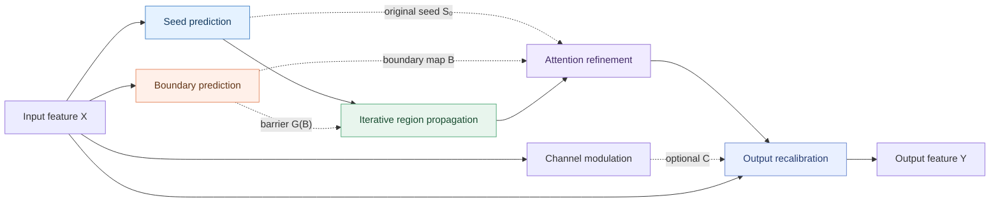

<div align="center">

# BRPA
### Boundary-guided Region Propagation Attention

**Seed discovery · Boundary-controlled spreading · Spatial refinement · Channel recalibration**

[](BRPA.py)
[](requirements.txt)
[](BRPA.py)
[](README_zh-CN.md)

**[English](README.md) | [简体中文](README_zh-CN.md)**

</div>

---

> [!IMPORTANT]
> **Source fidelity.** The provided Python file implements BRPA and ablation settings. The supplied LaTeX manuscript describes **TCPELIA**, a different module. Therefore, this repository **does not** attribute that manuscript's paper title, numerical results, or publication information to BRPA. The exact uploaded Python code is preserved at [`BRPA.py`](BRPA.py).

## Overview

**BRPA (Boundary-guided Region Propagation Attention)** is a PyTorch attention module that starts from an estimated seed map and iteratively extends spatial responses under an optional boundary barrier. The resulting attention map can be refined and used with an optional channel modulation branch to recalibrate the input feature map.

The implementation provides switches for **component ablations**, **propagation depth**, **spreading operators**, **propagation rate**, **boundary barriers**, and **output recalibration**. It is a **feature-processing module**, not a complete detector or an end-to-end training pipeline.

### Module at a glance



*The diagram shows the complete module. Individual ablation variants omit the corresponding optional branches.*

## Quick start

### 1. Install the requirement

Use an environment with a working PyTorch installation:

```bash
python -m pip install -r requirements.txt
```

The only runtime Python dependency in the uploaded BRPA implementation is **PyTorch**. No specific minimum version has been established by the supplied files.

### 2. Run a standalone forward pass

```python
import torch
from BRPA import BRPA

x = torch.randn(2, 64, 40, 40)  # [batch, channels, height, width]
module = BRPA(channels=64, steps=2)
y = module(x)

print(x.shape, y.shape)  # torch.Size([2, 64, 40, 40]) x 2
```

Try the runnable example:

```bash
python examples/basic_usage.py
```

### 3. Select the complete component configuration

**The supplied Python file defaults to an ablation**, not to the complete configuration:

```python
# BRPA.py — settings in the uploaded file
COMPONENT_VARIANT = "seed_prop_boundary_refine"
PROP_STEPS = 4
ENABLE_CHANNEL = False
```

To activate **all BRPA branches**, edit `BRPA.py` *before instantiating the model*:

```python
COMPONENT_VARIANT = "full"
PROP_OPERATOR = "maxpool3"
BARRIER_MODE = "soft"
RECALIBRATION_MODE = "full"
# Set PROP_STEPS to the depth required by your experiment.
```

`BRPA(channels=64, steps=2)` explicitly overrides `PROP_STEPS` for that instance. **No particular propagation depth or measured score is presented here as the paper-validated BRPA configuration**, because the supplied manuscript is about TCPELIA.

## Project layout

```text
BRPA-GitHub-Release/
├── BRPA.py                            # Searchable, documented BRPA implementation
├── README.md                          # English documentation (this page)
├── README_zh-CN.md                    # 中文说明
├── requirements.txt                   # Runtime dependency
├── .gitignore
├── examples/
│   ├── basic_usage.py                 # Forward pass and backward check
│   └── integration_example.py         # Minimal feature-block integration
├── tests/
│   ├── test_brpa.py                   # Behavior and shape checks
│   └── test_source_compatibility.py   # Compare against the uploaded source
├── docs/
│   ├── METHOD.md                      # Implementation-based method description
│   ├── METHOD_zh-CN.md                # 中文数学原理与参数说明
│   ├── GITHUB_PUBLISH_zh-CN.md        # Publishing / search discoverability
│   └── SOURCE_PROVENANCE.md          # Supplied-source audit and hash
└── reference/
    └── BRPA_ablation_original.py      # Byte-for-byte copy of uploaded BRPA code
```

## Tests and source provenance

Run:

```bash
python -m unittest discover -s tests -v
python BRPA.py
```

See [source provenance and SHA-256](docs/SOURCE_PROVENANCE.md). The compatibility tests compare numerical outputs from `BRPA.py` to the **uploaded original code** under matched initialization, for a selection of component and propagation options. They cannot establish the accuracy, training reproducibility, or completeness of an external detection system.


## Citation and license

This project is licensed under the MIT License.
---

<div align="center">

**BRPA** · Boundary-guided Region Propagation Attention

[Source code](BRPA.py) · [Method](docs/METHOD.md) · [中文版](README_zh-CN.md) · [Publishing guide](docs/GITHUB_PUBLISH_zh-CN.md)

</div>
