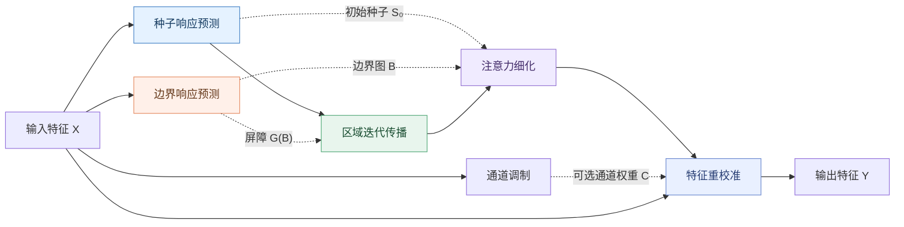

<div align="center">

# BRPA
### 边界引导区域传播注意力

**种子响应预测 · 边界约束传播 · 空间注意力细化 · 通道重校准**

[](BRPA.py)
[](requirements.txt)
[](BRPA.py)
[](README.md)

**[English](README.md) | [简体中文](README_zh-CN.md)**

</div>

---

> [!IMPORTANT]
> **关于来源的说明：**本次上传的 Python 源码确实实现了 BRPA，但上传的 LaTeX 论文研究的是 **TCPELIA**，而不是 BRPA。因此，此仓库不将该论文的题目、实验结果、发表信息或其他结论归属于 BRPA。未经修改的原始文件保留在 [`reference/BRPA_ablation_original.py`](reference/BRPA_ablation_original.py)。

## 项目简介

**BRPA（Boundary-guided Region Propagation Attention，边界引导区域传播注意力）** 是一个基于 PyTorch 实现的特征处理模块。其基本思想为：先预测局部种子响应，再利用邻域传播扩大候选响应区域，通过可选的边界屏障限制传播，最后结合空间注意力细化、可选的通道调制与残差重校准输出特征。

源代码具备较完整的**消融配置开关**，可分析组件组合、传播次数、传播算子、传播率、边界约束形式，以及空间/通道重校准方式的影响。**BRPA 是注意力模块，不是包含训练脚本和检测模型的完整工程。**

### 方法结构



*上图为完整组件组合的机制示意图；在不同消融配置下，部分分支可能不存在。*

## 快速开始

### 1. 安装依赖

在可正常使用 PyTorch 的 Python 环境下执行：

```bash
python -m pip install -r requirements.txt
```

原始 BRPA 模块只有 PyTorch 这一项第三方运行依赖；所上传的材料没有证明特定的最低版本要求，因此本仓库不虚构依赖版本。

### 2. 单独运行 BRPA

```python
import torch
from BRPA import BRPA

x = torch.randn(2, 64, 40, 40)
module = BRPA(channels=64, steps=2)
y = module(x)

print("输入：", x.shape)
print("输出：", y.shape)
```

输入和输出形状均为 `[2, 64, 40, 40]`。运行示例：

```bash
python examples/basic_usage.py
```

### 3. 启用完整的 BRPA 组件

**请注意：上传源码默认配置不是完整 BRPA。** 原始代码中的默认值为：

```python
COMPONENT_VARIANT = "seed_prop_boundary_refine"
PROP_STEPS = 4
ENABLE_CHANNEL = False
```

上面的配置包含种子预测、边界传播和注意力细化，但未启用通道调制。若需要全部组件，在 `BRPA.py` 中将设置改为：

```python
COMPONENT_VARIANT = "full"
PROP_OPERATOR = "maxpool3"
BARRIER_MODE = "soft"
RECALIBRATION_MODE = "full"
# PROP_STEPS 依据你的具体实验自行设定。
```

若在创建模块时传入 `BRPA(channels=64, steps=2)`，则该实例的传播次数会覆盖文件顶部的 `PROP_STEPS`。由于上传的 LaTeX 文件不是 BRPA 论文，本项目**不将任何传播次数标记为经 BRPA 论文验证的最优参数**。

## 核心计算过程

定义输入特征为 $X\in\mathbb{R}^{B\times C\times H\times W}$，种子图 $S_0$ 和边界图 $B$ 的尺寸均为 $B\times1\times H\times W$。单次传播过程为：

$$
\Delta_t=\operatorname{ReLU}\left(\mathcal{P}(S_t)-S_t\right),
\qquad S_{t+1}=\operatorname{clip}\left(S_t+p\,G(B)\odot\Delta_t,0,1\right).
$$

其中，$\mathcal{P}$ 表示指定的传播算子，$p$ 为有效传播率，$G(B)$ 为屏障门控。原始 `soft` 模式采用 $G(B)=1-B$。若启用空间细化，则：

$$
A=\sigma\left(\operatorname{Conv}_{3\times3}([S_K,S_0,B])\right).
$$

完整组件组合的输出公式为：

$$
C=\sigma\left(\operatorname{MLP}(\operatorname{GAP}(X))\right),
\qquad Y=X+A\odot X\odot C.
$$

以上公式均根据**本次实际上传的 Python 代码**整理，不代表已根据 BRPA 正式论文逐项核验。详细解析参见 [中文数学原理](docs/METHOD_zh-CN.md)。

## 消融实验配置

| 配置变量 | 作用 | 支持的值 |
|---|---|---|
| `COMPONENT_VARIANT` | 组件组合 | `identity`, `seed`, `seed_prop`, `seed_prop_boundary`, `seed_prop_boundary_refine`, `full` |
| `PROP_STEPS` | 传播次数 | `0`～`5` |
| `PROP_OPERATOR` | 传播算子 | `maxpool3`, `avgpool3`, `maxpool5`, `conv3` |
| `PROP_RATE_MODE` | 传播率 | `learnable`, `fixed` |
| `BARRIER_MODE` | 屏障形式 | `none`, `soft`, `hard`, `shifted`, `power` |
| `RECALIBRATION_MODE` | 输出方式 | `spatial`, `spatial_channel`, `spatial_residual`, `full` |
| `ENABLE_CHANNEL` | 通道分支 | `True`, `False`；`full` 模式强制开启 |

> [!NOTE]
> 原始源码的 `get_brpa_ablation_tag()` 采用全局配置拼接实验名称，**不能准确反映构造函数中显式覆盖的 `steps`**；此外，末尾的 `Chan/NoChan` 文本仅由 `ENABLE_CHANNEL` 决定，即使 `COMPONENT_VARIANT="full"` 已开启通道分支，也可能显示 `NoChan`。开展正式实验时应同时记录 `print(module)` 和 `get_effective_p()` 的结果，不能只依靠标签进行实验追踪。

## 文件结构

```text
BRPA-GitHub-Release/
├── BRPA.py                            # BRPA 主实现，便于代码搜索
├── README.md                          # 英文项目首页
├── README_zh-CN.md                    # 中文项目首页
├── requirements.txt                   # 运行依赖
├── .gitignore                         # 排除缓存与模型大文件
├── examples/
│   ├── basic_usage.py                 # 前向与反向传播示例
│   └── integration_example.py         # 与 PyTorch 特征块集成
├── tests/
│   ├── test_brpa.py                   # 功能和形状检查
│   └── test_source_compatibility.py   # 与原始实现数值一致性检查
├── docs/
│   ├── METHOD.md                      # 英文机制与参数说明
│   ├── METHOD_zh-CN.md                # 中文机制与参数说明
│   ├── GITHUB_PUBLISH_zh-CN.md        # 上传及 GitHub 检索设置
│   └── SOURCE_PROVENANCE.md          # 源码来源和 SHA-256 校验
└── reference/
    └── BRPA_ablation_original.py      # 原始代码备份，内容不变
```

## 验证方式

```bash
python -m unittest discover -s tests -v
python BRPA.py
```

另有 [源码溯源与 SHA-256 校验记录](docs/SOURCE_PROVENANCE.md)。其中，数值一致性测试使用相同随机初始化，检查整理后的源码与原始 BRPA 在若干组件变体、传播设置下是否输出一致。**该检查不是模型精度测试，也不代表检测网络可直接复现论文指标。**

## 已包含与未包含的内容

| 内容 | 状态 |
|---|---|
| BRPA 模块源代码 | ✅ 已包含 |
| 上传原始源码 | ✅ 已保留 |
| 中英文说明、基础示例和测试 | ✅ 已包含 |
| 数据集、标注、模型权重 | ❌ 未上传，故不提供 |
| YOLO/Ultralytics 项目改动与训练脚本 | ❌ 未上传，不能伪造 |
| BRPA 正式论文题目、DOI 和引用 | ❌ 现有材料无法核实 |
| 开源许可证 | ❌ 未由作者指定，暂不添加 |

在 YOLO 等现有检测框架中集成时，可先把 `BRPA(channels=特征通道数)` 作为 PyTorch 模块插入相应的特征处理节点，再依照具体框架完成模块注册和模型配置。当前代码包不提供不存在的训练命令或虚构的 YAML 文件。

## 引用与许可

如果后续明确了与 BRPA 对应的论文，请再补充真实参考文献与 DOI。**不要将当前上传的 TCPELIA 论文误写成 BRPA 论文。** 由于作者尚未提供开源许可，本项目未擅自添加 MIT、Apache-2.0 等许可证；公开仓库并不自动授予他人复制与二次分发权利。

---

<div align="center">

**BRPA** · Boundary-guided Region Propagation Attention

[主代码](BRPA.py) · [中文原理](docs/METHOD_zh-CN.md) · [English README](README.md) · [GitHub 上传说明](docs/GITHUB_PUBLISH_zh-CN.md)

</div>
